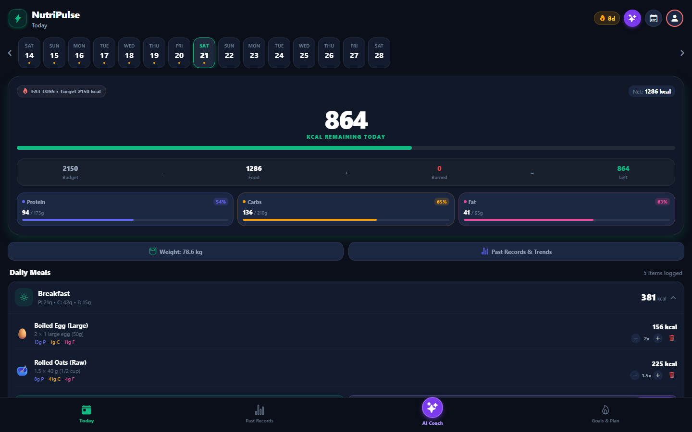
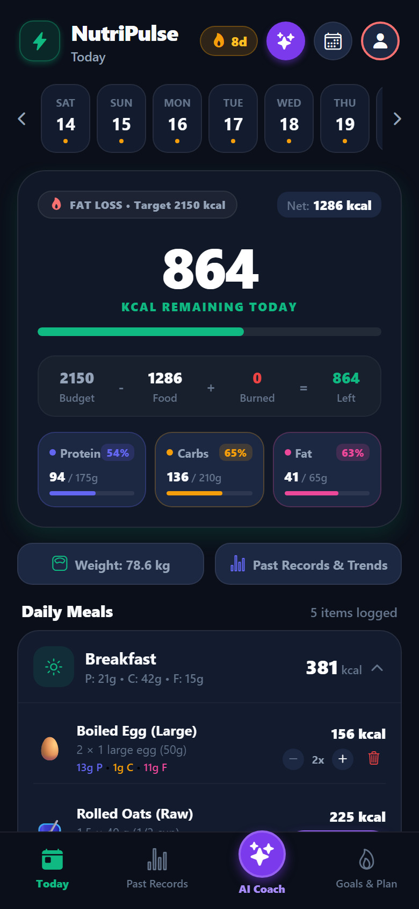

# NutriPulse — AI Calorie & Nutrition Tracker

A cross-platform calorie, macro and fitness tracker built with **Expo + React Native + TypeScript**. Runs on Android, iOS and the web from one codebase, with an optional AI food scanner and coach powered by NVIDIA Nemotron.



<p align="center">
  
</p>

## Features

- **Daily calorie budget** — budget, food, exercise burned and calories remaining at a glance
- **Macro tracking** — protein, carbs and fat progress against personal targets
- **Meal logging** — breakfast, lunch, dinner and snacks with portion multipliers and a built-in food database
- **AI food scanner** — describe a meal and get calorie and macro estimates (NVIDIA Nemotron, with a free fallback)
- **AI Coach** — personalised nutrition and fitness advice
- **Water, exercise and weight tracking**, plus streaks
- **History and trends** — past records with analytics charts and a calendar date picker
- **Goals and plan** — BMR/TDEE calculated with the Mifflin-St Jeor equation for fat loss, maintenance or gain
- **Onboarding and profile**, with data stored on the device

## Tech stack

| Layer | Tools |
| --- | --- |
| Framework | Expo SDK 57, React Native 0.86, React 19 |
| Language | TypeScript |
| Navigation | React Navigation (bottom tabs and native stack) |
| UI | expo-linear-gradient, Reanimated, Expo Vector Icons, Haptics |
| Storage | AsyncStorage, expo-secure-store |
| AI | NVIDIA NIM API (Nemotron), Pollinations fallback |
| Deploy | EAS Build (mobile), Vercel (web) |

## Getting started

```bash
git clone https://github.com/legend0x01/calorie.git
cd calorie
npm install

npm run web       # run in the browser
npm run android   # Android emulator / Expo Go
npm run ios       # iOS simulator / Expo Go
```

### AI setup (optional)

Get a free API key at [build.nvidia.com](https://build.nvidia.com) and paste it into the app when prompted. The key is stored only on your device. You can also tap **Continue with Local Analysis** to use the app without a key.

## Project structure

```
src/
├── components/   # Calorie rings, meal cards, trackers, modals
├── constants/    # Food database, theme
├── context/      # NutriContext (global app state)
├── screens/      # Today, History, AI Coach, Goals & Profile, Onboarding, Auth
├── services/     # AI, auth and backend services
├── types/        # Shared TypeScript types
└── utils/        # BMR calculator, date helpers
```

## License

Released under the [MIT License](LICENSE).
